# TutorsAtHome (ProfesoresACasa)

[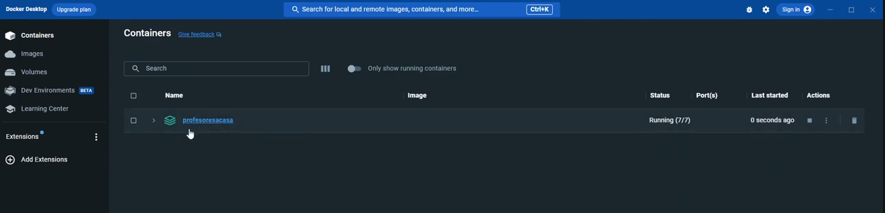](https://www.youtube.com/watch?v=qjc6L4i1CjM)

A distributed web application built for the **Distributed Applications Development** course at Universidad Rey Juan Carlos. The platform connects private tutors who publish lesson offers with students looking to hire them. Users can act as both tutor and student simultaneously.

## Features

### Public (unauthenticated)
- Browse tutor posts with pagination
- View tutor profiles and their offers
- Register a new account

### Private (authenticated)
- Publish and manage your own lesson offers
- Book a tutor by creating a contract
- Manage your contracts (as teacher or student)
- Report posts for policy violations
- Rate posts (1–5 stars)
- Edit your profile name and bio
- Delete your account

## Data Model

| Entity | Description |
|--------|-------------|
| `User` | Platform account — can act as both tutor and student |
| `Post` | A tutor's lesson offer with title, description, price, and rating |
| `Contract` | A hiring agreement between a student and a tutor for a specific post |
| `Report` | A policy violation report on a post |
| `Ranking` | Running average star rating for a post |

## Architecture

```
┌───────────────────────────────────────────────────────────┐
│                      HAProxy (port 443)                   │
│                    Round-robin load balancer               │
└──────────────────┬────────────────────┬──────────────────┘
                   │                    │
          ┌────────▼───────┐   ┌────────▼───────┐
          │  web1 (:8443)  │   │  web2 (:8443)  │
          │  Spring Boot   │   │  Spring Boot   │
          │  + Hazelcast   │◄──►  + Hazelcast   │
          └────────┬───────┘   └────────┬───────┘
                   │                    │
       ┌───────────▼────────────────────▼──────────┐
       │               MySQL 8                      │
       └────────────────────────────────────────────┘
                   │
          ┌────────▼───────┐
          │    RabbitMQ    │
          └────────┬───────┘
                   │
          ┌────────▼───────┐
          │  email-service │  (consumes queue, sends Gmail notifications)
          └────────────────┘
```

**Key technologies:** Spring Boot 2.7, Spring Security, Spring Data JPA, Mustache templates, Hazelcast distributed sessions, RabbitMQ (AMQP), MySQL 8, HAProxy, Docker Compose.

## Notification Events

The email microservice (`servicio_correo`) listens on a RabbitMQ queue and sends Gmail notifications for:

| Code | Event |
|------|-------|
| `S`  | User registration |
| `I`  | New post published |
| `P`  | Post deleted |
| `N`  | New contract created |
| `C`  | Contract cancelled |
| `R`  | Report submitted |
| `D`  | Account deleted |

## Architecture Diagrams

### UML — Main app (ProfesoresACasa)
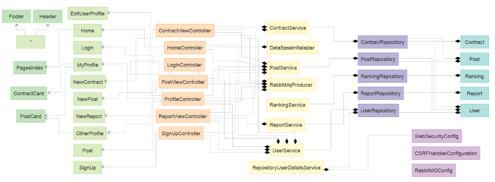

> Legend: Orange = Controller · Green = Template · Purple = Repository · Blue = Model · Violet = Config · Yellow = Service

### UML — Email service (ServicioCorreo)
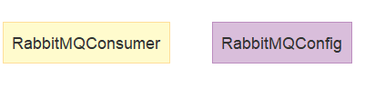

### Navigation diagram
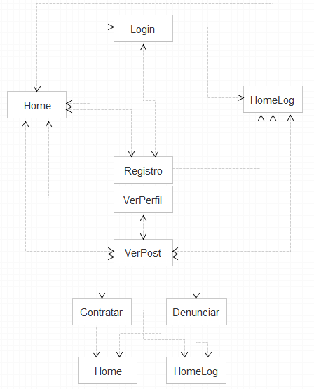

### Infrastructure
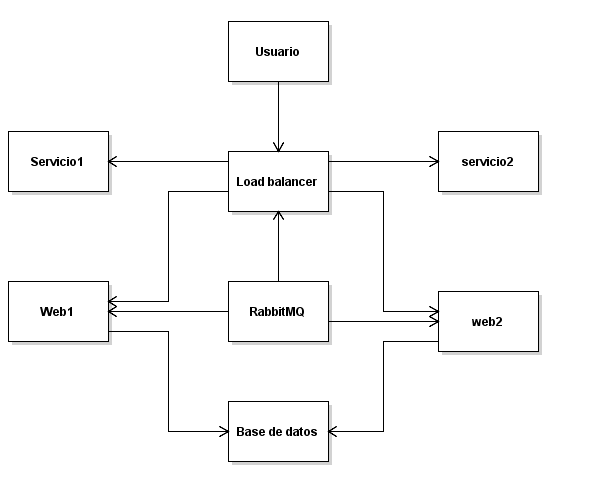

## Running with Docker Compose

### Prerequisites
- Docker and Docker Compose installed
- A Gmail account with an [App Password](https://support.google.com/accounts/answer/185833) configured

### Configuration

No secrets live in the repository. `docker-compose.yml` reads them from a `.env` file next to it (git-ignored):

```bash
cp .env.example .env
# then edit .env:
#   SSL_KEYSTORE_PASSWORD  any password for the HTTPS keystore
#   MAIL_ORIGIN            Gmail address the email service sends from
#   MAIL_PASSWORD          its 16-character App Password
```

`docker compose` refuses to start if any of them is missing.

**HTTPS keystore.** Both web replicas read `certs/keystore.jks` (git-ignored, mounted at `/app/certs`). If it does not exist, the first replica generates a self-signed one with `SSL_KEYSTORE_PASSWORD`. To create it yourself beforehand (recommended, so both replicas start with the same certificate):

```bash
mkdir -p certs
keytool -genkeypair -alias profesoresacasa -keyalg RSA -keysize 2048 -validity 365 \
  -dname "CN=localhost" -storetype JKS -keystore certs/keystore.jks \
  -storepass "$SSL_KEYSTORE_PASSWORD" -keypass "$SSL_KEYSTORE_PASSWORD"
```

> ⚠️ **Never commit real credentials to source control.** `.env`, `certs/` and `*.jks` are git-ignored.

### Start

```bash
docker compose up --build
```

Access the app at **https://localhost:9443** (self-signed certificate — accept the browser warning).

## Manual Setup (without Docker)

### 1. Install prerequisites

```bash
sudo apt install default-jre mysql-server rabbitmq-server
```

### 2. Configure MySQL

```bash
sudo mysql
```
```sql
CREATE USER 'test'@'localhost' IDENTIFIED BY 'test.profesoresACasa';
GRANT ALL PRIVILEGES ON *.* TO 'test'@'localhost' WITH GRANT OPTION;
CREATE SCHEMA profesoresACasa;
exit
```

### 3. Build the JARs

```bash
cd profesores_a_casa && mvn clean package -DskipTests && cd ..
cd servicio_correo   && mvn clean package -DskipTests && cd ..
```

### 4. Create a local HTTPS keystore

The main app serves HTTPS and reads its keystore from `SSL_KEYSTORE` (default `classpath:keystore.jks`) with the password in `SSL_KEYSTORE_PASSWORD`. Generate a self-signed one outside the repository and point the app at it:

```bash
export SSL_KEYSTORE_PASSWORD=choose-a-password
keytool -genkeypair -alias profesoresacasa -keyalg RSA -keysize 2048 -validity 365 \
  -dname "CN=localhost" -storetype JKS -keystore ~/profesoresacasa-keystore.jks \
  -storepass "$SSL_KEYSTORE_PASSWORD" -keypass "$SSL_KEYSTORE_PASSWORD"
export SSL_KEYSTORE=file:$HOME/profesoresacasa-keystore.jks
```

`SSL_KEY_PASSWORD` defaults to `SSL_KEYSTORE_PASSWORD`; set it only if the key has its own password.

### 5. Run both services (in separate terminals)

```bash
# terminal 1 (with SSL_KEYSTORE and SSL_KEYSTORE_PASSWORD exported)
java -jar profesores_a_casa/target/profesores_a_casa-1.0.jar

# terminal 2
export MAIL_ORIGIN=your.address@gmail.com
export MAIL_PASSWORD=your-16-char-app-password
java -jar servicio_correo/target/servicio_correo-1.0.jar
```

Browse to **https://localhost:8443** once both services are running.

## Screenshots

| Home | Login | Sign Up |
|------|-------|---------|
| 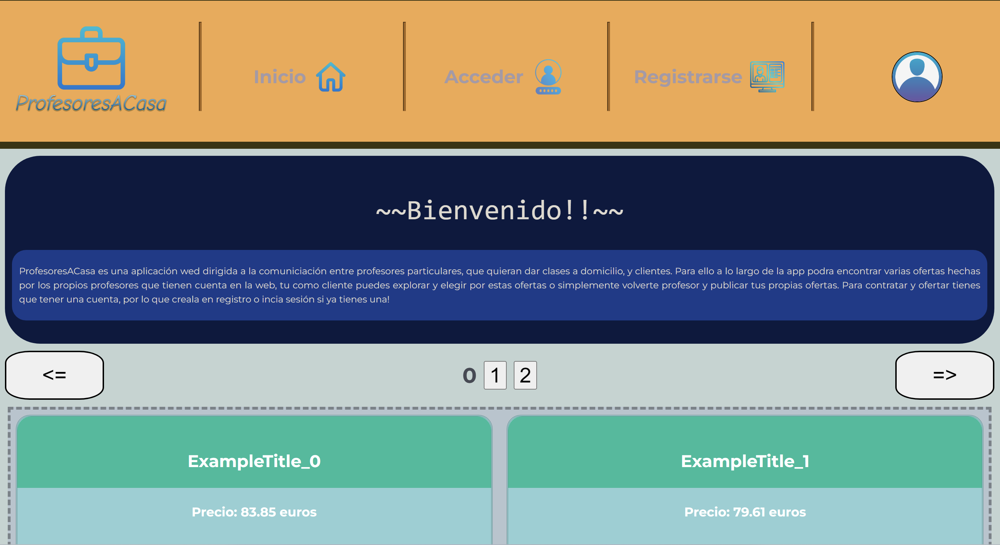 | 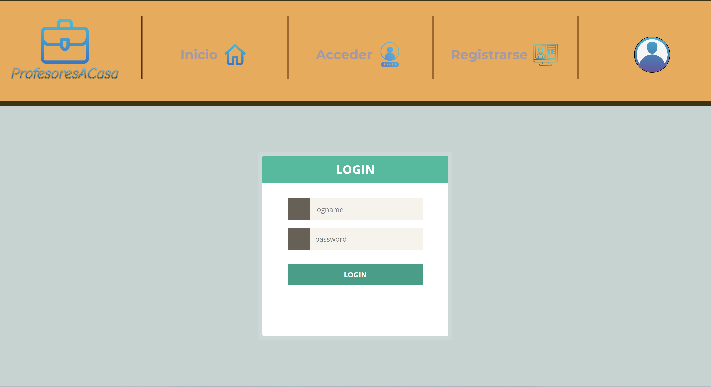 | 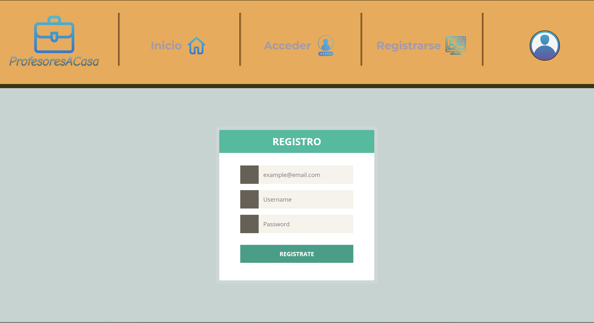 |

| My Profile | Post Detail | Book a Tutor |
|------------|-------------|--------------|
| 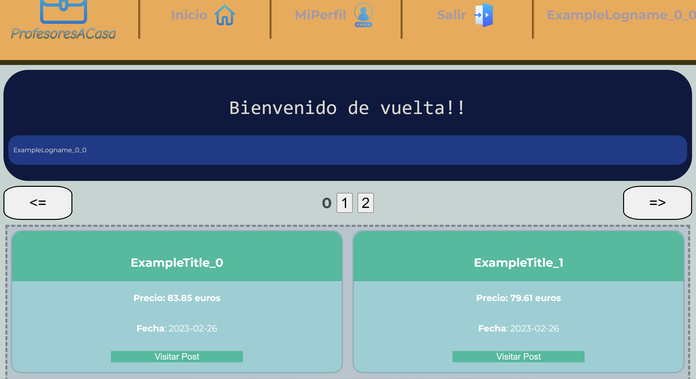 | 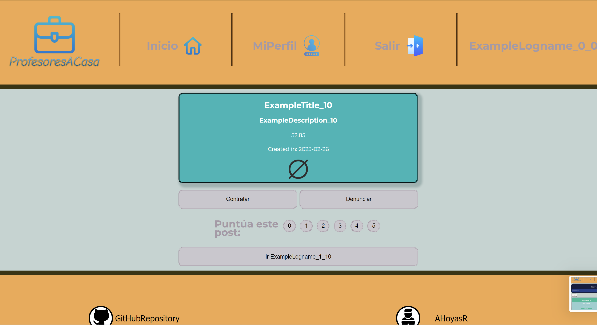 | 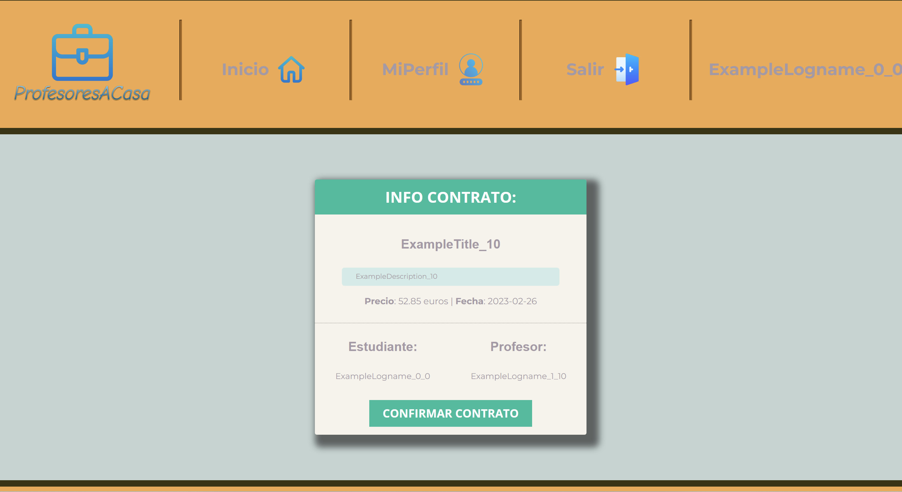 |

## Authors

- [Sebas1705](https://github.com/Sebas1705)
- [AHoyasR](https://github.com/AHoyasR)
